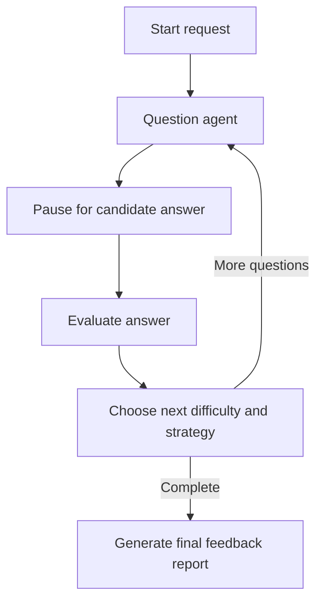

# InterviewPilot — Adaptive AI Interview Practice

InterviewPilot is an interview-practice prototype that adapts questions and difficulty to a candidate's answers. It uses a stateful LangGraph workflow with a human-in-the-loop pause/resume step, a FastAPI web server, and Google Gemini for question generation and evaluation.

## What it demonstrates

- **Adaptive question flow:** creates role-focused questions and adjusts the next difficulty using the current interview state.
- **Human-in-the-loop execution:** pauses for a candidate answer and resumes the same graph using a thread ID.
- **Structured outputs:** Pydantic models validate question, evaluation, and difficulty-decision responses.
- **Fallback handling:** retries some structured-output operations and falls back to deterministic defaults for supported paths.
- **Separate interview state:** each interview gets its own thread ID.
- **API surface:** candidate-facing endpoints for starting an interview, submitting an answer, and reading session state.
- **Developer tooling:** Swagger docs and a LangServe playground for inspecting the graph.

## Architecture



The graph uses `InMemorySaver` for session checkpointing. This is useful for a local demo, but in-memory state is lost when the process restarts and is not a durable multi-instance production store.

## Technology

- Python
- FastAPI and Uvicorn
- LangChain and LangGraph
- LangServe
- Google Gemini (`langchain-google-genai`)
- Pydantic
- `python-dotenv`

## Run locally

### Prerequisites

- Python 3.10 or newer
- A Google Gemini API key

### Setup

```bash
git clone https://github.com/vidwansai66/interviewpilot.git
cd interviewpilot
python -m venv .venv
```

Activate the environment and install dependencies:

```bash
# Windows PowerShell
.venv\Scripts\Activate.ps1

# macOS / Linux
source .venv/bin/activate

pip install -r requirements.txt
```

Create your local environment file:

```bash
# macOS / Linux
cp .env.example .env
```

On Windows, copy `.env.example` to `.env` using File Explorer or `Copy-Item .env.example .env` in PowerShell.

Set `GOOGLE_API_KEY` in `.env` to your own Gemini API key. The application also accepts `GEMINI_API_KEY`. `MODEL_NAME` selects the Gemini model name; update it if the configured model is unavailable to your account.

Start the application:

```bash
python server.py
```

Open [http://localhost:8080](http://localhost:8080).

## API endpoints

| Method | Endpoint | Purpose |
|---|---|---|
| POST | `/api/start` | Start a new interview and return its thread ID and first question |
| POST | `/api/answer` | Submit an answer and resume the same graph execution |
| GET | `/api/state/{thread_id}` | Read the current state of an interview |
| GET | `/health` | Health check |
| GET | `/docs` | Interactive Swagger API docs |
| GET | `/interview/playground` | LangServe playground for development/demo use |

## Configuration and limitations

- The app requires a valid Gemini API key for model-backed behavior.
- `InMemorySaver` is process-local; sessions do not survive process restart and this is not a durable distributed persistence strategy.
- LLM feedback can be incorrect or inconsistent. It is practice feedback, not a certified assessment of a candidate's ability.
- The repository currently has no automated test suite. Add tests for question count limits, session isolation, invalid thread IDs, structured-output fallbacks, and graph resume behavior.
- Keep `.env` untracked and never place API keys in the README, screenshots, logs, or frontend assets.

## Next engineering steps

1. Add pytest coverage for graph transitions, session isolation, and fallback paths.
2. Add GitHub Actions to run tests and a lightweight application import/startup check.
3. Add a short demo recording and sanitized sample interview output.
4. Consider durable checkpoint storage if sessions must survive restarts.
